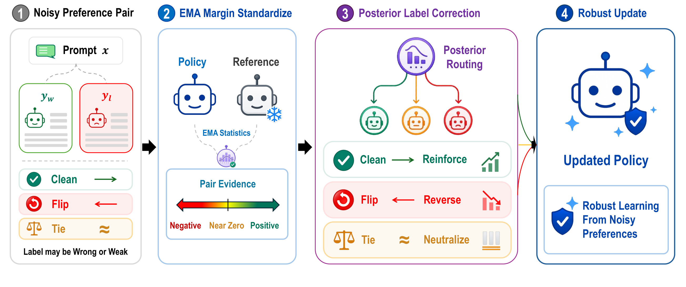

<h1>PLC-DPO <small>(Findings of EMNLP 2026)</small></h1>

<h3>
  Posterior Label Correction in Noisy and Ambiguous Preference Optimization
</h3>

<p>
  Boryeong Cho, Sumyeong Ahn<sup>†</sup>, and Se-Young Yun<sup>†</sup>
  <br>
  <sup>†</sup>Corresponding authors
</p>

<p>
  <a href="https://arxiv.org/abs/2608.30597"></a>
  <a href="LICENSE"></a>
  <a href="https://github.com/VennTum99/PLC-DPO"></a>
</p>

Official code repository for **PLC-DPO: Posterior Label Correction in Noisy and Ambiguous Preference Optimization**.

## 📰 News

- **Sep 14, 2026:** The official initial code implementation is released at [PLC-DPO](https://github.com/VennTum99/PLC-DPO).
- **Aug 31, 2026:** Our paper is submitted to [arXiv](https://arxiv.org/abs/2608.30597).
- **Aug 21, 2026:** PLC-DPO is accepted to **Findings of EMNLP 2026**!

## 💡 Overview

Preference datasets often contain incorrect preference directions or pairs with weak or ambiguous preferences. PLC-DPO treats each observed pairwise label as a latent **clean**, **flip**, or **tie** state and uses the calibrated policy–reference margin to infer a posterior-like routing distribution over these states. This routing determines whether training reinforces the observed preference, reverses its direction, or neutralizes strong directional updates.

PLC-DPO combines forward DPO, reversed DPO, and tie-regularizing losses using these routing weights. EMA-based margin calibration, warm-up, and confidence-gated mixing stabilize routing and defer aggressive corrections when evidence is uncertain. The method reuses the policy and reference log-probabilities already required by DPO, so it needs no auxiliary model or additional supervision during training.



This release includes DPO and three PLC-DPO training settings on clean UltraFeedback Binarized, together with evaluation code.

Additional code and materials used in our experiments will be released in future updates.

## 📊 Main results

PLC-DPO win rates (%) against the one-epoch DPO baseline, as reported in the paper. Both methods are trained on **clean UltraFeedback Binarized (UFB)**.

| Model | UFB | Alpaca | Alpaca2 | MT-Bench | Vicuna | Evol-Instruct | HH-RLHF |
|---|---:|---:|---:|---:|---:|---:|---:|
| Qwen2.5-1.5B | 52.48 | 55.03 | 57.70 | 42.50 | 66.88 | 58.82 | 45.78 |
| Phi-2 | 56.83 | 60.68 | 61.24 | 53.12 | 77.50 | 56.58 | 50.06 |
| Qwen2.5-7B | 58.80 | 58.14 | 61.37 | 59.38 | 76.88 | 62.98 | 65.40 |
| Llama-3-8B | 56.8 | 58.5 | 60.1 | 63.8 | 62.5 | 53.5 | 63.3 |
| Mistral-7B | 55.6 | 57.9 | 58.4 | 55.0 | 67.5 | 55.6 | 64.2 |

## 🔧 Installation

```bash
conda create -n plcdpo python=3.11.15 -y
conda activate plcdpo
python -m pip install torch==2.10.0 torchvision==0.25.0 torchaudio==2.10.0 \
  --index-url https://download.pytorch.org/whl/cu128
python -m pip install -r requirements/train.txt
python -m pip install flash-attn==2.8.3 --no-build-isolation
python -m pip install -e .
python -m pip check
```

The training environment uses Python 3.11 and CUDA 12.8, with a C/C++ compiler for kernel compilation.
For data preparation alone, use `python -m pip install -e '.[data]'`.

For vLLM evaluation, use a separate Python 3.12 environment and run:

```bash
python -m pip install -r requirements/eval.txt
python -m pip install -e .
```

## 🗂️ Data preparation

Download and prepare the `train_prefs` split of `HuggingFaceH4/ultrafeedback_binarized`:

```bash
python -m plcdpo.prepare_data --dataset ultrafeedback-binarized
```

This creates `train.parquet`, `order_seed42.csv`, and `manifest.json` under `data/ultrafeedback-binarized/`. Use `--revision` to select an upstream commit and `--seed` to change the data order.

## 🚀 Training

Run from the repository root. YAML files are merged from left to right.

```bash
CUDA_VISIBLE_DEVICES=0,1 NPROC_PER_NODE=2 bash scripts/train.sh \
  --config configs/train.yaml configs/models/qwen2.5-1.5b.yaml \
  configs/datasets/ultrafeedback-binarized.yaml configs/methods/dpo.yaml \
  --set output_dir=outputs/qwen1.5b-dpo

CUDA_VISIBLE_DEVICES=0,1 NPROC_PER_NODE=2 bash scripts/train.sh \
  --config configs/train.yaml configs/models/qwen2.5-1.5b.yaml \
  configs/datasets/ultrafeedback-binarized.yaml configs/methods/plc-dpo-aggressive.yaml \
  --set output_dir=outputs/qwen1.5b-plc
```

For a single GPU, omit `NPROC_PER_NODE=2`. Training uses LoRA rank 16, learning rate 1e-5, one epoch, and effective batch size 64.
Model settings are provided for Qwen2.5-1.5B, Qwen2.5-7B, Llama-3-8B, and Mistral-7B.

Choose `plc-dpo-aggressive.yaml`, `plc-dpo-balanced.yaml`, or `plc-dpo-conservative.yaml`:

| Hyperparameter | Aggressive | Balanced | Conservative |
|---|---:|---:|---:|
| EMA decay $\alpha$ | 0.98 | 0.99 | 0.995 |
| Direction temperature $\tau_{\mathrm{dir}}$ | 0.55 | 0.75 | 1.00 |
| Tie temperature $\tau_{\mathrm{tie}}$ | 1.15 | 1.00 | 0.85 |
| Warm-up fraction $\rho_{\mathrm{warm}}$ | 0.07 | 0.10 | 0.15 |
| Maximum correction strength $\gamma_{\max}$ | 0.85 | 0.70 | 0.50 |
| Confidence power $\kappa$ | 0.8 | 1.0 | 1.5 |

Use `--dry-run` to inspect settings or `--check-data` to validate prepared data.
Each run saves the adapter, tokenizer, configuration, and manifest. Use a separate output directory for each run.

## 📏 Evaluation

Prepare prompts, generate responses, and score them with a reward model:

```bash
bash scripts/evaluate.sh prepare --dataset vicuna --output data/eval/vicuna.jsonl

bash scripts/evaluate.sh generate --input data/eval/vicuna.jsonl \
  --base-model AIR-hl/Qwen2.5-1.5B-ultrachat200k \
  --adapter outputs/qwen1.5b-plc --model-config configs/models/qwen2.5-1.5b.yaml \
  --temperature 0 --top-p 1 --output results/plc-predictions.jsonl

bash scripts/evaluate.sh score --input results/plc-predictions.jsonl \
  --reward-model Skywork/Skywork-Reward-V2-Llama-3.1-8B \
  --output results/plc-scores.jsonl
```

Repeat generation and scoring for `outputs/qwen1.5b-dpo`, saving `results/dpo-predictions.jsonl` and `results/dpo-scores.jsonl`, then compare:

```bash
bash scripts/evaluate.sh compare --baseline results/dpo-scores.jsonl \
  --input results/plc-scores.jsonl --output results/win-rate.json
```

Win rate is `100 × (wins + 0.5 × ties) / N`. Evaluation uses the same prompts for both models and compares reward scores.
Available prompt sets are UltraFeedback, AlpacaEval, Vicuna, Evol-Instruct, HH-RLHF, and MT-Bench with turns combined into one prompt (`mtbench-flat`).

## 🤝 Acknowledgements

This codebase was initially developed from [SelectiveDPO](https://github.com/glorgao/SelectiveDPO). We sincerely thank the authors for sharing their work and code with the community, which provided a valuable foundation for our research.

## 📄 License

This repository is licensed under Apache-2.0. Dataset and model licenses apply separately.

## 📚 BibTeX

If you find this repository useful for your research, we would appreciate it if you could cite our work.

```bibtex
@misc{cho2026plcdpoposteriorlabelcorrection,
      title={PLC-DPO: Posterior Label Correction in Noisy and Ambiguous Preference Optimization},
      author={Boryeong Cho and Sumyeong Ahn and Se-Young Yun},
      year={2026},
      eprint={2608.30597},
      archivePrefix={arXiv},
      primaryClass={cs.LG},
      url={https://arxiv.org/abs/2608.30597},
}
```

AI coding tools assisted in refactoring and cleaning this repository. We ran regression checks to verify that the refactor preserves the original implementation's behavior.